# Awesome LLM Programming Frameworks

  

<table>
  <tr>
    <td align="left">
      
      
    </td>
    <td align="right">
      
    </td>
  </tr>
</table>

> **The curated list of LLM programming frameworks, prompt optimization tools, and modular AI pipeline frameworks — 8 hosted SaaS platforms and 57 open-source GitHub projects, compared side by side.**

**Curated List of SaaS Products & Open-Source GitHub Projects**  
*Focused on Prompt Optimization, Declarative Programming & Modular AI Pipelines*  
🗓️ **Last updated: October 2026** · 57 open-source projects · 8 SaaS platforms

## 📚 Table of Contents

- [🧠 What Are LLM Programming Frameworks?](#-what-are-llm-programming-frameworks)

- [💡 Why LLM Programming Frameworks Matter](#-why-llm-programming-frameworks-matter)

- [👥 Who This List Is For](#-who-this-list-is-for)

- [📈 Sector Overview & Market Dynamics](#-sector-overview--market-dynamics)

- [🏢 SaaS/Hosted Platforms](#-saashosted-platforms)

- [🐙 Open-Source GitHub Projects](#-open-source-github-projects)

- [❓ Frequently Asked Questions (FAQ)](#-frequently-asked-questions-faq)

- [🤝 How to Contribute](#-how-to-contribute)

- [🚨 Disclaimer](#-disclaimer)

- [☕ Support](#-support)

- [📈 Star History](#-star-history)

## 🧠 What Are LLM Programming Frameworks?

An **LLM programming framework** is a library or platform for building, composing, and **automatically optimizing** applications powered by large language models. Rather than hand-writing a prompt string and hoping it holds up, you describe the *program* — its inputs, outputs, modules and evaluation metric — and the framework compiles that program into optimized prompts (and, in some cases, optimized weights).

Three capabilities define the category:

| 💡 Capability | What it means | 🛠️ Representative tools |
| --- | --- | --- |
| **Declarative pipelines** | You describe the pipeline structure; the framework handles the plumbing. | DSPy, LangChain, LlamaIndex, Haystack, Semantic Kernel |
| **Prompt optimization** | Prompts become learnable parameters, improved automatically against a metric. | DSPy, GEPA, PromptWizard, Prompt Optimizer, AdalFlow, Promptomatix |
| **Evaluation & observability** | Systematic scoring, tracing, red-teaming and regression tests for LLM apps. | Promptfoo, DeepEval, OpenAI Evals, LiteLLM |

The shift matters because **manual prompt engineering does not scale**. Hand-tuned prompts break silently whenever the model, the schema, or the data changes. A framework turns prompt quality into something you can **measure, version and improve automatically** — which is what teams actually need to ship reliable LLM features.

## 💡 Why LLM Programming Frameworks Matter

- 🔄 **Reliability over vibes.** Evaluation harnesses and regression suites turn "it feels better" into a number you can gate CI on.
- 🔌 **Portability.** Vendor-neutral abstractions (OpenAI-compatible APIs, MCP, JSON Schema tool contracts) let you swap models without rewriting your app.
- 💸 **Cost control.** Automatic optimization, caching and gateway-level routing keep token spend down and steer easy prompts to small models.
- 👥 **Team scale.** Shared prompt libraries, versioning and review workflows make prompts a first-class, auditable artifact.
- 🔒 **Self-hosting.** Every open-source project in this list can run entirely on your own infrastructure — no per-seat SaaS pricing and no prompt data leaving your VPC.

## 👥 Who This List Is For

| 🧑‍💻 Role | 🛠️ Start with |
| --- | --- |
| **ML engineers & researchers** | Optimization frameworks (DSPy, GEPA, PromptWizard) and evaluation harnesses (Promptfoo, DeepEval). |
| **Backend & platform engineers** | Orchestration runtimes (LangGraph, Semantic Kernel, Eino, LangChain4j) and gateways (LiteLLM, vLLM, TGI). |
| **Prompt engineers** | Prompt management and versioning (PromptHub, Promptolution, PUPT, pocket-prompt). |
| **Indie hackers & product teams** | Hosted platforms with real free tiers (PromptBase, FlowGPT, AIPRM, Snack Prompt). |
| **Platform & IT teams** | Self-hosted, permissively licensed tooling (Dify, Open WebUI, Ollama). |

🧭 This repository tracks notable **SaaS platforms** and **open-source projects** in the **LLM programming frameworks** ecosystem. These tools shift the paradigm from manual prompt engineering to programmatic, optimizable pipelines — treating prompts as learnable parameters, enabling systematic improvement against metrics, and providing modular abstractions for building AI systems.

**Featured tools include** DSPy, PromptBase, PromptHero, AIPRM, FlowGPT, Snack Prompt, ChatHub, PromptPerfect, and PromptFolder.

**Open-source emphasis**: this section is heavily expanded with every major active project for self-hosting, prompt optimization, and transparent AI programming — ideal for ML engineers, researchers, and teams building vendor-neutral LLM applications.

🙏 Contributions welcome! Open an PR to add/update entries. Keep descriptions factual and link to official sites.

🔎 **Popular searches:** *LLM frameworks · prompt optimization tools · prompt engineering platforms · declarative prompt programming · AI pipeline frameworks · self-hosted LLM stack · prompt management and versioning · LLM evaluation and red teaming · best prompt engineering SaaS*

## 📈 Sector Overview & Market Dynamics

The **prompt engineering and prompt management software** sector is a **~$0.4–0.5B global market** in 2024–2025, growing at roughly **33% CAGR** toward **~$2B by 2030** (Market.us: $381.7M in 2024 at 33.9% CAGR; Precedence Research: $505.18M in 2025 at ~32.9% CAGR; Grand View Research: $222.1M in 2023 → $2.06B by 2030 at 32.8%). Wider definitions that bundle in agent frameworks, evaluation and observability are much larger — Mordor Intelligence sizes **prompt engineering + agent programming tools at $6.95B in 2025, reaching $40.87B by 2030 (42.52% CAGR)** — but that figure covers far more than prompt tooling alone.

The market is **moderately fragmented, not winner-take-all**. Grand View Research explicitly characterises prompt engineering as a **fragmented** market with "numerous market participants and product launches" — specialist vendors such as PromptBase, PromptHero, Vellum and AIPRM compete alongside large platform players, while the adjacent prompt-management niche (Langfuse, Humanloop, PromptLayer, LangSmith, Maxim AI) shows no single dominant vendor. The structural driver is that **prompt tooling is being absorbed into LLM development, observability and evaluation platforms**, so standalone vendors keep re-benchmarking themselves against bundled features; expect continued consolidation rather than a clean monopoly.

## 🏢 SaaS/Hosted Platforms

*Sorted by company size (revenue / valuation) descending. Pricing and free-tier figures were verified against each vendor's own pricing pages in October 2026.*

| Product | Description | 💲 Pricing | 🆓 Free Tier Limits | 📊 Company Size (Revenue / Valuation) |
| --- | --- | --- | --- | --- |
| **[FlowGPT](https://flowgpt.com/)** | Community platform with 220K+ creators for sharing and discovering prompts. Multi-model chat across ChatGPT, Claude, Gemini and Llama, reusable "Flows" mini-apps, and token-based (Flux/Mochi) pricing. | **Plus $14.99/mo** ($144.99/yr); **Ultra $24.99/mo** ($244.99/yr). Flux/Mochi token consumption is charged on top of the subscription. | **Free forever:** full community prompt library + **5 free chat models**. Paid tiers add **25 free chats every 4 hours** across featured models (Plus) and 50 (Ultra). | **$60M raised** (July 2026) by parent company **Kaon AI** at a *several-hundred-million* valuation; earlier **$10M pre-Series A** (Feb 2024). Estimated **~$1.9M annual revenue** (July 2025). Millions of monthly users across 110 countries. |
| **[PromptPerfect](https://promptperfect.jina.ai/)** | Prompt optimization tool that rewrites prompts with an explanation for every change. Modes: Better, Specific, Chain-of-Thought. Now also available as a self-hostable open-source release (see below). | **Standard $20/mo**, **Premium $100/mo** (Jina AI's last published prices, March 2024). ⚠️ The hosted service **shut down on 1 September 2026** after Elastic acquired Jina AI — self-host the open-source build instead. | **No permanent free tier:** a **7-day free trial** of a paid plan (the announcement mentions daily limits but never quantifies them). The open-source self-hosted version is free and unlimited. | Maker **Jina AI**, **$39M raised** ($30M Series A, Nov 2021) and **acquired by Elastic for $43.3M** (Oct 2025); parent Elastic reported **$1.483B FY2025 revenue**. |
| **[Snack Prompt](https://snackprompt.com/)** | Prompt discovery and management platform with 220K+ prompt creators and 22M+ prompts opened. Team collaboration, shared knowledge bases, multi-model comparison, text snippets and a Chrome plugin. | **No subscription tier** — per-item marketplace sales (individual prompts from **$2.99 one-time**) plus a paid team plan quoted on request. | **Free forever account:** unlimited public prompt discovery and remixing, plus **5 free generation credits every day**. Creator monetization is pay-per-prompt, not subscription. | **~$20.5M proposed deal value** (S&P Capital IQ) in a 2025 Spectral Capital term sheet that also brought up to **$5M growth capital** — *terminated May 2026*. Earn-out tied to a **$4M ARR** milestone. **220K+ creators**, 22M+ prompts opened, 7-person team. |
| **[AIPRM](https://www.aiprm.com/)** | Chrome extension with 4,500+ curated ChatGPT prompts used by 2M+ users. Team prompt libraries, custom profiles, prompt variables, advanced search and verified prompts. | **Plus $20/mo** or **$200/yr**; **Pro $39/mo** or **$390/yr**; **Elite One $79/mo** or **$790/yr**; **Titan $999/mo** or **$9,990/yr**. Annual billing adds two free months. Multi-seat team plans quoted separately. | **Free forever** (unlimited trial duration): all Community Prompts (5,400+ public), up to **2 private prompt templates**, **1 public upcoming prompt**, **1 favourite prompt template**. | **~$930K ARR** (third-party model-based estimate: ~$77.5K MRR, Sept 2026). **2,000,000+ users**, 5,400+ public and 345K+ private prompts. Bootstrapped — no funding round disclosed. |
| **[PromptHero](https://prompthero.com/)** | Prompt search engine covering Stable Diffusion, Midjourney, DALL·E and ChatGPT, backed by millions of AI-generated images with their prompts. Also runs PromptHero Academy prompt-engineering courses. | **Starter $16/mo billed yearly ($194/yr)** — 3,600 generation credits, private generations, every AI model. **Pro $24/mo billed yearly ($296/yr)** — 7,200 credits, priority queue, fewer content restrictions. Extra credit packs: **1,000 credits $59**, **2,000 credits $99** (never expire). | **Free forever:** limited daily generations (vendor publishes no numeric daily cap), standard speed at lower priority, all creations public, personal use only. Students/artists can request extended access via trial@prompthero.com. | **Acquired by ElevenYellow (Nov 2024)** — sale price undisclosed. Two-founder team with **0 employees** at the time of sale; **2M+ monthly visits** and ~1,000 new users/day (company-reported). |
| **[ChatHub](https://chathub.gg/)** | Browser extension and desktop/mobile app for running ChatGPT, Gemini, Claude, Llama, Grok, DeepSeek and 20+ models side-by-side. Uses your own accounts/API keys or a built-in service; prompt library, local searchable history and custom OpenAI-compatible chatbots. | **Pro $19/mo** or **$14.99/mo billed annually** — 10,000 basic + 1,500 advanced model queries, 300 image generations, 300 document uploads per month. **Unlimited $39/mo** or **$24.99/mo billed annually** — uncapped queries, 1,000 image generations, unlimited uploads. Team seats on request. | **Free forever:** two chatbots side-by-side with limited usage (the vendor publishes no numeric message cap), plus the prompt library and local chat history. | **300,000+ users** (company-reported). Bootstrapped with an estimated **1–5 employees**; no funding, valuation or revenue figure disclosed. Also open-sourced on GitHub. |
| **[PromptBase](https://promptbase.com/)** | Marketplace for buying and selling prompts for text, image, and video models (GPT, Midjourney, DALL·E, Sora, Kling). Creators can sell prompts, build AI apps and earn from app-generation credits. | **PromptBase Select $19/mo** ($14/mo billed annually) — 10 eligible prompt downloads/mo + 1,000 generation credits. **Creator $19/mo**, **Pro $39/mo**. Marketplace takes a **20% commission** on sales. Individual prompts list from **$1.99**. | **Free forever:** 10 generation credits/month in the AI app builder (changed from daily to monthly in Sept 2025); full marketplace browsing is free; individual prompts can be bought one-off from $1.99. | **Unfunded bootstrap** (founded 2022, no public funding round). No disclosed revenue or valuation; a top-tier prompt marketplace monetising a **20% commission** on creator sales plus paid **Select/Creator/Pro** plans. Team size not published. |
| **[PromptFolder](https://promptfolder.com/)** | Chrome extension for saving and organizing prompts across ChatGPT, Claude, Bard and Bing AI. Slash (/) quick-access, cloud sync, privacy settings, prompt variables and folders. | **PromptFolder Pro $8/mo** — the only paid tier. | **Free forever:** up to **100 stored prompts** across **5 folders** (third-party guides report these caps; the vendor does not publish them on-site). | **Founder-led side project** (built by Cole South for his e-commerce business). **4,000 Chrome Web Store** extension users; no funding, valuation, revenue or headcount disclosed. |

## 🐙 Open-Source GitHub Projects

*Every project below is open source and self-hostable. Stars_Counts are live, pulled from the GitHub API on October 2026, and the list is sorted by GitHub_Stars descending. Each Stars_Badge links to that project's stargazers page.*

| Project | ⭐ GitHub_Stars | 📜 License | 🗂️ Category | 📝 Description |
| --- | --- | --- | --- | --- |
| **[Ollama](https://github.com/ollama/ollama)**  | 184.2k | MIT | Local Runtime | Run and serve open models locally with a single command — the default local runtime for self-hosted LLM pipelines. |
| **[Dify](https://github.com/langgenius/dify)**  | 159.2k | Apache-2.0 | App Builder | Build agentic workflows and RAG pipelines on one collaborative workspace, deployable to cloud, VPC or fully self-hosted. |
| **[Open WebUI](https://github.com/open-webui/open-webui)**  | 156.4k | BSD-3-Clause | App Builder | User-friendly self-hosted AI interface with built-in prompt tooling for Ollama, OpenAI-compatible APIs and RAG. |
| **[LangChain](https://github.com/langchain-ai/langchain)**  | 148.2k | MIT | Orchestration | The de-facto agent engineering platform. Composable primitives for chaining LLM calls, tools and retrievers into production pipelines. |
| **[Generative AI for Beginners](https://github.com/microsoft/generative-ai-for-beginners)**  | 121.8k | MIT | Cookbooks & Learning | 21 lessons for getting started building with generative AI — the standard guided on-ramp for new LLM developers. |
| **[vLLM](https://github.com/vllm-project/vllm)**  | 94.8k | Apache-2.0 | Inference & Serving | High-throughput, memory-efficient inference and serving engine for LLMs, with continuous batching and OpenAI-compatible endpoints. |
| **[OpenAI Cookbook](https://github.com/openai/openai-cookbook)**  | 76.7k | MIT | Cookbooks & Learning | Official examples and guides for using the OpenAI API — evals, retrieval, structured outputs and agent patterns. |
| **[LiteLLM](https://github.com/BerriAI/litellm)**  | 61.7k | MIT | Gateway & Observability | Fast AI gateway calling 100+ LLM APIs in OpenAI format, with cost tracking, guardrails, load balancing and logging. |
| **[Flowise](https://github.com/FlowiseAI/Flowise)**  | 55.5k | Apache-2.0 | App Builder | Visual builder for AI agents and LLM chains — drag-and-drop pipelines that export clean code when you outgrow the canvas. |
| **[Anthropic Cookbook](https://github.com/anthropics/claude-cookbooks)**  | 53.7k | MIT | Cookbooks & Learning | Notebooks and recipes from Anthropic showing effective ways of using Claude, including RAG and tool-use patterns. |
| **[LlamaIndex](https://github.com/run-llama/llama_index)**  | 52.6k | MIT | Orchestration | Data framework for connecting LLMs to private corpora — ingestion, indexing and retrieval for RAG-heavy applications. |
| **[LangGraph](https://github.com/langchain-ai/langgraph)**  | 43.7k | MIT | Orchestration | Graph-based runtime for resilient agents: explicit state, cycles and human-in-the-loop checkpoints instead of opaque chains. |
| **[FastChat](https://github.com/lm-sys/FastChat)**  | 39.5k | Apache-2.0 | Inference & Serving | Open platform for training, serving and evaluating LLMs; release repo for Vicuna and the Chatbot Arena leaderboard. |
| **[Prompt Optimizer](https://github.com/linshenkx/prompt-optimizer)**  | 38.8k | MIT | Prompt Optimization | Browser- and CLI-based prompt optimizer with multi-model comparison and systematic prompt rewriting for better outputs. |
| **[DSPy](https://github.com/stanfordnlp/dspy)**  | 38.7k | MIT | Prompt Optimization | The leading framework for programming—not prompting—language models. Declarative signatures plus optimizers that compile prompts and weights against metrics automatically. |
| **[OpenAI Agents SDK](https://github.com/openai/openai-agents-python)**  | 30.2k | MIT | Orchestration | Lightweight framework for multi-agent workflows with handoffs, guardrails and built-in tracing. |
| **[Semantic Kernel](https://github.com/microsoft/semantic-kernel)**  | 28.7k | MIT | Orchestration | Microsoft's SDK for embedding LLM calls in C#, Python and Java, with plug-in abstractions and process orchestration. |
| **[Haystack](https://github.com/deepset-ai/haystack)**  | 26.8k | Apache-2.0 | Orchestration | Production AI orchestration with explicit control over retrieval, routing, memory and generation; strong RAG and agent story. |
| **[Promptfoo](https://github.com/promptfoo/promptfoo)**  | 26.2k | MIT | Evaluation & Ops | Test prompts, agents and RAG pipelines; red-team and scan for vulnerabilities, then compare GPT/Claude/Gemini/DeepSeek side by side. Declarative config, CI/CD ready. |
| **[Google ADK (Python)](https://github.com/google/adk-python)**  | 21.9k | Apache-2.0 | Orchestration | Code-first toolkit for building, evaluating and deploying multi-agent systems with a flexible agent model. |
| **[Guidance](https://github.com/guidance-ai/guidance)**  | 21.8k | MIT | Orchestration | A constraint language for controlling LLM output — token-level steering, regex and JSON enforcement inside the generation loop. |
| **[OpenAI Evals](https://github.com/openai/evals)**  | 19.6k | MIT | Evaluation & Ops | Framework for evaluating LLMs and LLM systems, plus an open-source registry of benchmarks. |
| **[DeepEval](https://github.com/confident-ai/deepeval)**  | 19k | Apache-2.0 | Evaluation & Ops | The LLM evaluation framework — pytest-style assertions, metric scoring and CI integration for production LLM apps. |
| **[Microsoft Agent Framework](https://github.com/microsoft/agent-framework)**  | 14.3k | MIT | Orchestration | Successor framework for orchestrating agents and multi-agent workflows across Python and .NET. |
| **[Eino](https://github.com/cloudwego/eino)**  | 13.4k | Apache-2.0 | Orchestration | Go-native LLM application development framework with composable component interfaces and built-in streaming support. |
| **[LangChain4j](https://github.com/langchain4j/langchain4j)**  | 13.3k | Apache-2.0 | Orchestration | Idiomatic Java library for LLM apps on the JVM — AI Services, tool calling, RAG and MCP support, Spring Boot friendly. |
| **[txtai](https://github.com/neuml/txtai)**  | 13k | Apache-2.0 | Orchestration | All-in-one framework embedding vector search, graph networks and LLM orchestration into a single stack. |
| **[Ludwig](https://github.com/ludwig-ai/ludwig)**  | 11.8k | Apache-2.0 | Training & Serving | Low-code declarative framework for training and serving custom LLMs, with a config-driven approach to model definition. |
| **[PocketFlow](https://github.com/The-Pocket/PocketFlow)**  | 11.3k | MIT | Orchestration | A 100-line minimalist LLM framework where agents are nodes in a graph. Tiny surface area, easy to read and audit. |
| **[Promptflow](https://github.com/microsoft/promptflow)**  | 11.3k | MIT | Evaluation & Ops | Build high-quality LLM apps end to end — prototyping, testing, deployment and monitoring in one developer-centric workflow. |
| **[Text Generation Inference](https://github.com/huggingface/text-generation-inference)**  | 10.9k | Apache-2.0 | Inference & Serving | Production-grade text generation server with tensor parallelism, token streaming and continuous batching. |
| **[AutoAgent](https://github.com/HKUDS/AutoAgent)**  | 9.8k | MIT | Orchestration | Fully automated, zero-code framework that generates and iterates on agent systems from a natural-language goal. |
| **[Context Engineering Handbook](https://github.com/jasontang-ai/Context-Engineering)**  | 9.3k | MIT | Prompt Optimization | First-principles handbook on context design, orchestration and optimization — the step beyond manual prompt engineering. |
| **[GEPA](https://github.com/gepa-ai/gepa)**  | 7.1k | MIT | Prompt Optimization | Reflective prompt evolution: an optimizer that reflects on trajectories and evolves prompts far beyond one-shot rewriting. |
| **[Promptify](https://github.com/promptslab/Promptify)**  | 4.6k | Apache-2.0 | Prompt Optimization | Prompt engineering plus prompt versioning in one library — extract, structure and version prompts into reusable components. |
| **[AdalFlow](https://github.com/SylphAI-Inc/AdalFlow)**  | 4.2k | MIT | Prompt Optimization | The library to build and auto-optimize LLM applications. Single-optimizer LLM-AutoDiff approach with fewer abstractions than DSPy. |
| **[PromptWizard](https://github.com/microsoft/PromptWizard)**  | 4k | MIT | Prompt Optimization | Task-aware, agent-driven prompt optimization that synthesises and critiques prompts for a target task automatically. |
| **[Prompt Engine](https://github.com/microsoft/prompt-engine)**  | 2.8k | MIT | Prompt Optimization | A small library of helpers for developers crafting prompts for large language models. |
| **[PromptHub (legeling)](https://github.com/legeling/PromptHub)**  | 1.7k | AGPL-3.0 | Prompt Management | All-in-one AI toolbox for prompt, agent and skill management with one-click distribution to 15+ platforms and MCP management. |
| **[GPTSwarm](https://github.com/metauto-ai/GPTSwarm)**  | 1.1k | MIT | Prompt Optimization | Self-improving agents with reinforcement learning and prompt optimization — treats prompts as trainable policy parameters. |
| **[Prompt-Ops](https://github.com/meta-llama/prompt-ops)**  | 1k | MIT | Prompt Optimization | Meta's open-source tool for LLM prompt optimization, applying optimization techniques from Meta's own research. |
| **[Promptomatix](https://github.com/SalesforceAIResearch/promptomatix)**  | 980 | Apache-2.0 | Prompt Optimization | Salesforce's automatic prompt optimization framework for large language models, covering instruction and few-shot generation. |
| **[SAMMO](https://github.com/microsoft/sammo)**  | 781 | MIT | Prompt Optimization | Structure-aware Multi-Objective Metaprompt Optimization — mutates prompt structure, not just wording, and scores on multiple objectives. |
| **[Trace](https://github.com/microsoft/Trace)**  | 762 | MIT | Prompt Optimization | End-to-end generative optimization for AI agents: observability wired directly into a closed-loop optimizer. |
| **[Awesome-LLM-Prompt-Optimization](https://github.com/jxzhangjhu/Awesome-LLM-Prompt-Optimization)**  | 420 | MIT | Prompt Optimization | Curated list of prompt optimization and tuning methods for LLMs — the paper-level map of the field. |
| **[Dynamic Prompts](https://github.com/adieyal/dynamicprompts)**  | 165 | MIT | Prompt Management | Templating language for combinatorial prompt generation with wildcard syntax and MagicPrompt model integration for Stable Diffusion workflows. |
| **[Promptolution](https://github.com/gepromptet/promptolution)**  | 157 | Apache-2.0 | Prompt Optimization | Unified, modular framework for prompt optimization with iterative routines, token-budget callbacks and multiple optimizer algorithms (OPRO, EvoPrompt, CAPO). |
| **[MarciAI](https://github.com/marciaiorg/marciai)**  | 13 | GPL-3.0 | Prompt Management | Open-source alternative to AIPRM for ChatGPT — free Chrome extension with 5,000+ curated prompts, variables and advanced search. |
| **[PromptPerfect (Open Source)](https://github.com/Beagle-AI-automation/promptperfect)**  | 8 | MIT | Prompt Management | Open-source prompt optimization tool (Next.js + Vercel AI SDK). Pick Better / Specific / Chain-of-Thought modes with explanations; BYOK, keys stay local. |
| **[PromptHub (FLi79Za)](https://github.com/FLi79Za/PromptHub)**  | 6 | MIT | Prompt Management | Self-hosted local web app for prompt management — Python + Flask + SQLite, no cloud sync, no accounts, no telemetry. |
| **[Exemplar Prompt Hub](https://github.com/shubhanshusingh/exemplar-prompt-hub)**  | 5 | MIT | Prompt Management | FastAPI-based prompt management service with versioning, tagging and SQLite/PostgreSQL backends. |
| **[LogiLLM](https://github.com/mjbommar/logillm)**  | 2 | MIT | Prompt Optimization | Zero-dependency enterprise alternative to DSPy using only the Python standard library — HybridOptimizer, persistence and Pydantic type safety. |
| **[pocket-prompt](https://github.com/dpshde/pocket-prompt-tui)**  | 1 | MIT | Prompt Management | Go-based prompt manager with template and CLI support — boolean tag search, clipboard formats, git sync and a live-search TUI. |
| **[pico-dspy](https://github.com/mbachry/pico-dspy)**  | 1 | MIT | Prompt Optimization | Stripped-down DSPy variant using pydantic-ai instead of litellm for faster import, with a migration path to full DSPy when GEPA or fine-tuning is needed. |
| **[PUPT](https://github.com/apowers313/pupt)**  | 0 | MIT | Prompt Management | CLI tool for managing and using AI prompts — Handlebars templates, interactive fuzzy search, history tracking and git/npm installs. |
| **[onux](https://github.com/MaximeRivest/onux)**  | 0 | MIT | Prompt Optimization | Keras-style symbolic DAGs for LLM programs — symbolic inputs, composable layers and model.compile(optimizer="auto_prompt"). |
| **[PromptHub (hbinr)](https://github.com/hbinr/PromptHub)**  | 0 | AGPL-3.0 | Prompt Management | Local-first open-source prompt and skill management with version control, variable templates, multi-model testing and WebDAV sync. |

### 📦 Also Available Outside GitHub

- **[Parolo](https://pypi.org/project/parolo/)** — Tiny, file-based prompt store with automatic versioning. Zero infrastructure, prompts stored as plain text with immutable versions, SHA-256 hashing to only create versions when content changes, Jinja2 rendering and hot-reload support for agents. Distributed via PyPI, so it has no GitHub Stars_Count.

**🧱 Frameworks for building custom systems**: Combine **DSPy** for declarative pipelines with automatic optimization, **Promptolution** for systematic prompt benchmarking, and **LogiLLM** for zero-dependency production deployment. For prompt management, layer in **PromptHub** for local-first storage with version control and **PUPT** for CLI-driven workflows. For visual prompt optimization, **PromptPerfect (Open Source)** provides browser-based improvement with explanations.

**🔑 Key architectural insight**: The **programming-not-prompting** paradigm (DSPy, LogiLLM, onux) treats prompts as learnable parameters optimized against metrics — a fundamentally different approach from manual prompt engineering. However, DSPy couples optimized prompts to its program abstraction (lock-in risk), while **Promptolution produces standalone prompt strings** for better portability across systems. Framework-specific patterns (orchestration topology, state management) should not be depended upon for portability; universal patterns like JSON Schema tool contracts and MCP interop are safe to rely on.

## ❓ Frequently Asked Questions (FAQ)

**What is the difference between an LLM framework and a prompt management tool?**
An LLM framework (DSPy, LangChain, LangGraph) orchestrates *how* your app calls the model — chaining, routing, tool use, state. A prompt management tool (PromptHub, PUPT, Promptolution) manages *the prompt itself* — storage, versioning, variables, sharing. Most production stacks use both together.

**Is DSPy still the best open-source prompt optimization framework?**
DSPy remains the most-starred and most widely adopted optimizer, and it is still the reference implementation for declarative prompt programming. The newer challengers each attack a different weakness: **GEPA** (reflective prompt evolution, 7.1k stars), **PromptWizard** (agent-driven synthesis, 4k stars) and **Promptomatix** (Salesforce, 980 stars) all outperform one-shot rewriting in their own benchmarks.

**What is the best free prompt engineering platform?**
It depends on the axis. **AIPRM** gives unlimited free access to 5,400+ public prompts via a Chrome extension; **PromptBase** gives 10 free generation credits a month plus free marketplace browsing; **FlowGPT** gives a free account with 5 chat models and the whole community library; **Snack Prompt** gives 5 daily generation credits; **ChatHub** gives two side-by-side chatbots free forever; **PromptFolder** caps free accounts at 100 prompts across 5 folders.

**Should I self-host an LLM framework or pay for a SaaS platform?**
Self-host when prompt data cannot leave your infrastructure, when you need reproducible optimization, or when per-seat SaaS pricing hurts at scale. Use a SaaS platform when you want a marketplace, a polished UI, or prompt optimization with no engineering time. The open-source options here (Dify, Open WebUI, Ollama, Prompt Optimizer) are production-viable and MIT/Apache licensed.

**How much does prompt engineering software cost?**
Individual plans run from **$8/month** (PromptFolder Pro) to **$24.99/month** (FlowGPT Ultra, monthly billing), with most tiers landing between $15 and $30/month and annual billing cutting roughly 20%. Team and enterprise plans are quoted per seat. Exact tiers and free-tier limits are in the [SaaS/Hosted Platforms](#-saashosted-platforms) table.

**How do I choose between a SaaS platform and an open-source framework?**
Start from constraints, not features: data residency, budget model, team skill, and whether you need a UI or a library. If you can ship code, prefer open source; if you need a marketplace or a browser extension today, prefer SaaS. Plenty of teams run both — an open-source runtime with a commercial prompt layer on top.

**What are the most popular LLM programming frameworks right now?**
By GitHub_Stars among the projects tracked here: **Ollama** (184.2k), **Dify** (159.2k), **Open WebUI** (156.4k), **LangChain** (148.2k) and **vLLM** (94.8k) lead the runtime layer, while **DSPy** (38.7k) and **Prompt Optimizer** (38.8k) lead the prompt-optimization layer.

**Can I use these frameworks with any LLM provider?**
Mostly yes. The strong open-source options (LiteLLM, Haystack, Semantic Kernel, LangChain, LlamaIndex) expose OpenAI-compatible interfaces or provider adapters for OpenAI, Anthropic, Google Gemini, Mistral, Meta Llama, DeepSeek, Groq and local models served through Ollama or vLLM.

## 🤝 How to Contribute

1. Fork the repo.

2. Add/edit your entry in `README.md` — the SaaS table lives under [🏢 SaaS/Hosted Platforms](#-saashosted-platforms) and the open-source table under [🐙 Open-Source GitHub Projects](#-open-source-github-projects).

3. Include: name, link, 1–2 sentence description, pricing and free-tier limits (SaaS only), license and category (open source only), and company size (SaaS only).

4. Sort the table by its stated key: company size descending for SaaS, Stars_Count descending for open source.

5. Submit a PR with a short explanation.

⭐ Star the repo if you find it useful!

## 🚨 Disclaimer

- This is a **community-curated** list — not exhaustive and not an endorsement.

- **License awareness**: DSPy, LogiLLM, Promptolution, pico-dspy, onux are MIT or Apache-2.0. PromptPerfect (Open Source) is open-source. MarciAI is open-source. PromptHub is open-source. Verify terms before commercial deployment.

- LLM programming frameworks manage API keys and sensitive data; ensure proper secret management and access controls when self-hosting.

- Prompt optimization requires evaluation data and metrics; DSPy and similar frameworks are most valuable when you have a clear objective function to optimize against.

---

**👩‍💻 Made for AI engineers, ML researchers, prompt engineers, and application developers.**  

Let's make LLM programming more open, systematic, and vendor-neutral.

---

## ☕ Support

**Thank you!** 🙏 This list is a labour of love, built and kept up to date in the open for the benefit of the entire LLM engineering community. If it saved you an afternoon, helped you choose a framework, or pointed you at a tool you would otherwise have missed — a **⭐ star**, a **🍴 fork** or a **💬 share** with your team makes an enormous difference.

| Action | What it actually helps with |
| --- | --- |
| ⭐ **Star** the repo | Keeps the list discoverable and signals which frameworks the community actually relies on. |
| 🍴 **Fork** it | Send a pull request — new frameworks, corrected pricing, better descriptions. |
| 💬 **Share** it | Drop it into your team's onboarding docs so the next engineer doesn't re-research the whole space. |
| ☕ **Buy me a coffee** | Funds the time spent re-verifying pricing tiers, Stars_Counts and company data every month. |

Every entry here was researched manually and checked against primary sources. If something looks out of date — a pricing change, a shut-down service, a renamed project — please open an issue or a pull request. Corrections are extremely welcome.

---

## 📈 Star History

